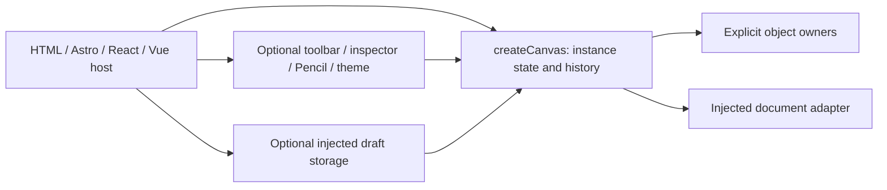
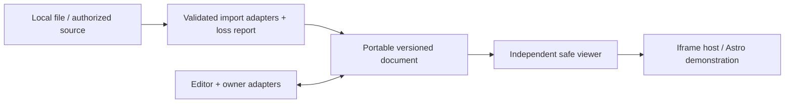

# Architecture: current system and target boundaries

## Current system

[Package exports](../../package.json) and [API](../API.md) are the current contract. Core manages registrations, selection, command policy, history and revisions. Owners capture/restore DOM-backed object state. The [document adapter](../../js/canvas-instance-document.js) validates bounded data and creates owners; hosts manage file IO, sizing, cleanup and optional storage. Core has no runtime framework dependency or publishing service.

Trust boundary: file data crosses validators before owners mutate; host-supplied owner functions are trusted application code. CSS surface coordinates assume positioned direct children on an untransformed host. Local editor integration is not an arbitrary DOM inspector.

## Proposed target

The document contract should not depend on editor DOM or framework lifecycle. Viewer code must not import authoring UI, drafts or mutation history. Importers produce plain records and provenance, not executable markup. Optional frontend/MCP adapters stay outside the visitor path.

Tradeoff: a second renderer adds parity work but makes viewer safety and size measurable. Reusing read-only editor code alone does not meet the independent-runtime gate. See [document](CANVAS-DOCUMENT-SPEC.md), [viewer](VIEWER-EMBED-SPEC.md), [security](../engineering/SECURITY.md) and [decision register](../product/DECISION-REGISTER.md).
